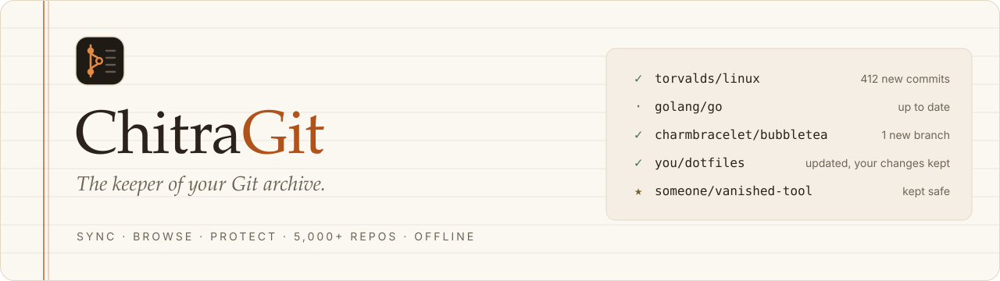
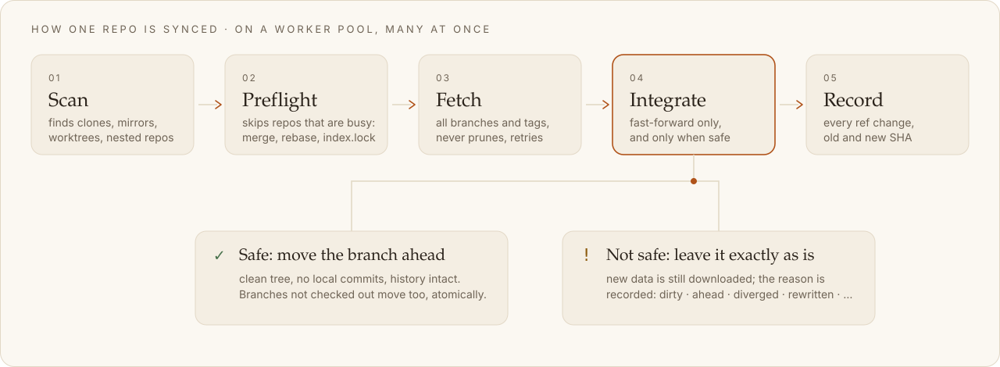
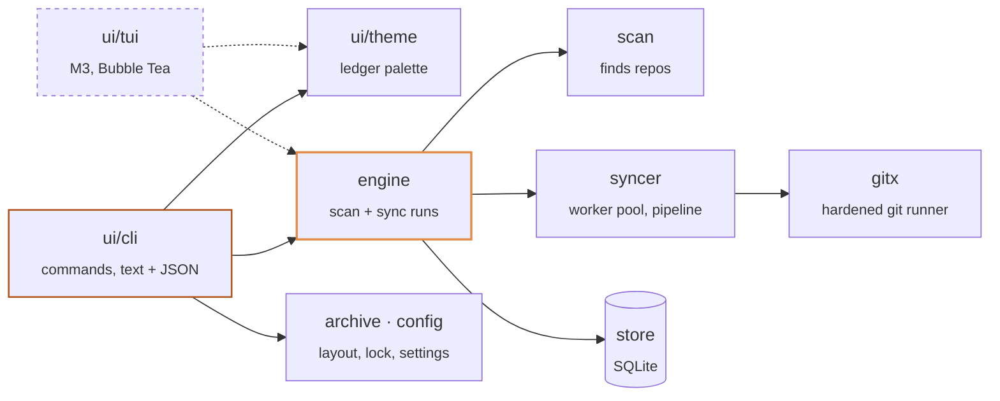

<div align="center">

<picture>
  <source media="(prefers-color-scheme: dark)" srcset="docs/assets/banner-dark.svg">
  
</picture>

<br><br>

[](https://github.com/TTox-Tech/chitragit/actions/workflows/ci.yml)
[](go.mod)
[](#quick-start)
[](LICENSE)

**[Why](#why-chitragit)** &nbsp;·&nbsp; **[Features](#features)** &nbsp;·&nbsp; **[Quick start](#quick-start)** &nbsp;·&nbsp; **[How sync works](#how-sync-works)** &nbsp;·&nbsp; **[Architecture](#architecture)** &nbsp;·&nbsp; **[Roadmap](#roadmap)** &nbsp;·&nbsp; **[Contributing](#contributing)**

</div>

> [!NOTE]
> **In active development.** The headless sync engine works today. The safety layer
> (stash and rollback) is being built now, and the interactive ledger (TUI, a full-screen
> terminal app) comes right after. Star or watch the repo to follow the launch.

<p align="center">
  
</p>

## Why ChitraGit?

*Chitragupta* is the divine record-keeper who never forgets a single entry.
ChitraGit does the same for your repos.

If you keep a folder full of cloned repositories (learning material, dependencies,
whole GitHub orgs, "just in case it disappears" copies), you know the pain:

- updating hundreds of clones means fragile shell loops,
- one `git pull` in the wrong repo and your local work is in a mess,
- you never notice when an upstream repo is **deleted, made private or taken down**,
  which is exactly when your copy becomes precious.

ChitraGit is a **local GitHub for your archive, but better**: offline, all in one place,
and actively guarding what you've collected.

## Features

| Feature | | Status |
|---|---|:-:|
| **Parallel sync for 5,000+ repos** | A worker pool updates many repos at once, with per-host limits, retries and timeouts. | **Today** |
| **Never touches your work** | Dirty, diverged or force-pushed repos still get the new data, but their branches and files stay exactly as they were. | **Today** |
| **Archive-safe history** | Branches and tags deleted upstream are kept. Nothing is pruned unless you ask. | **Today** |
| **Full headless CLI** | Every command has `--json` output and stable exit codes for scripts and schedulers. | **Today** |
| **Hardened git runner** | Hooks and `core.fsmonitor` inside archived repos never run, and no prompt can hang a run. | **Today** |
| **Zero data loss** | Local changes are stashed and re-applied; on any conflict the repo is restored exactly as it was. | M2 |
| **GUI-quality TUI** | Clickable, animated ledger: repo browser, README and commit views, activity feed, health dashboard. | M3 – M4 |
| **Rescued repos** | When a repo vanishes upstream it gets a badge, delete-protection and an optional single-file backup. | M5 |
| **Any forge** | GitHub, GitLab, Gitea / Forgejo / Codeberg or any plain Git URL. Smart skip asks the API what changed; tokens live in your OS keychain. | M5 |
| **Scheduling** | One-click daily or weekly runs with cron, launchd or Task Scheduler. No telemetry, ever. | M7 |

The full product spec, including 55+ edge cases and how each is handled, is in
[`docs/PRD.md`](docs/PRD.md).

## Quick start

Requires [Go 1.26+](https://go.dev/dl/) and Git 2.30+.

```sh
go install github.com/TTox-Tech/chitragit/cmd/chitragit@latest

cd ~/my-archive
chitragit init        # set up this folder as an archive
chitragit doctor      # check git, LFS, database, config, terminal
chitragit sync        # find every repo, then update them all in parallel
chitragit status      # health of every repo from the last sync
```

<details>
<summary><b>More commands</b></summary>

<br>

```sh
chitragit sync --mode dry-run      # ask the remotes what changed; download nothing
chitragit sync --mode fetch        # download only, never move a branch
chitragit sync --only 'torvalds/*' # just some repos
chitragit ls --status diverged     # repos that need a decision
chitragit sync --json              # versioned JSON ("schema": "chitragit/v1") for scripts
```

The first <kbd>Ctrl</kbd>+<kbd>C</kbd> lets repos that already started finish safely;
a second one exits at once.

</details>

<details>
<summary><b>Exit codes</b></summary>

<br>

| Code | Meaning |
|:-:|---|
| `0` | all good |
| `1` | some repos failed |
| `2` | bad flags or config |
| `3` | another run holds the archive |
| `4` | git missing or too old |
| `130` | stopped with <kbd>Ctrl</kbd>+<kbd>C</kbd> |

</details>

<details>
<summary><b>Configuration</b></summary>

<br>

Settings are layered (later wins): built-in defaults → your config → the archive's
config → `CHITRAGIT_*` environment variables → command-line flags.

```sh
chitragit config set sync.workers 32          # this archive only
chitragit config set --user ui.theme ledger   # all your archives
CHITRAGIT_SYNC_MODE=fetch chitragit ...       # one run
```

To skip folders, list names or globs in `scan.exclude`, or in a `.chitragitignore` file in
the archive root (one pattern per line; a pattern with `/` matches the path from the root).

</details>

## How sync works

<picture>
  <source media="(prefers-color-scheme: dark)" srcset="docs/assets/sync-pipeline-dark.svg">
  
</picture>

- **Scan** finds every repo at any depth: normal clones, bare and mirror clones, linked
  worktrees and repos nested inside other repos. Each one gets a stable ID stored in its
  own git config, so moving or renaming a folder keeps its history.
- **Fetch** downloads new commits, branches and tags from every remote. Branches and tags
  deleted upstream are **kept** in your copy (pruning is off unless you turn on `sync.prune`).
- **Integrate** fast-forwards a branch only when that is safe, meaning the branch simply
  moves ahead to the new commits. Branches that are not checked out are moved too,
  without touching any files.
- **Flaky networks are expected:** a per-repo timeout, retries with exponential backoff,
  a per-host limit (8 at a time for github.com by default) and a fast stop when a host
  is unreachable.

<details>
<summary><b>Every status, explained</b></summary>

<br>

When a repo is not fast-forwarded, the summary says why. The new data is downloaded in
every case except `busy`, `local_only` and `failed`.

| Status | What it means |
|---|---|
| `ok` | up to date, or moved ahead safely |
| `ahead` | you have local commits that are not pushed yet; nothing to apply |
| `dirty` | uncommitted changes; updates downloaded but not applied |
| `diverged` | you and upstream both have new commits; nothing was merged |
| `rewritten` | upstream rewrote its history (force-push); your branch was left as it was |
| `detached` | detached HEAD; no branch was moved |
| `no_upstream` | the current branch does not track a remote branch |
| `upstream_gone` | the branch it tracks no longer exists upstream |
| `empty` | the current branch has no commits yet |
| `blocked` | the update would overwrite local files |
| `busy` | a merge or rebase is in progress, or git is already running there |
| `local_only` | no remote configured; nothing to sync |
| `worktree` | a linked worktree, synced through its main repo |
| `failed` | an error; the summary gives a plain-language reason and a hint |

</details>

## Architecture

The engine is headless: the CLI today, and the TUI later, only call it and render results.
Every git call goes through one hardened runner.



<details>
<summary><b>Package map</b></summary>

<br>

| Package | Role |
|---|---|
| `cmd/chitragit` | entry point |
| `internal/ui/cli` | Cobra commands, text and JSON renderers |
| `internal/ui/theme` | colour palettes and styles shared by the CLI and the TUI |
| `internal/engine` | runs a scan or a sync and records the results |
| `internal/scan` | walks the archive and finds every kind of repo |
| `internal/syncer` | worker pool and the per-repo sync pipeline |
| `internal/gitx` | the only place that runs git; adds the security flags |
| `internal/store` | SQLite database (repos, runs, ref changes) |
| `internal/archive` | archive layout and the run lock |
| `internal/config` | layered settings and validation |
| `internal/provider` | forge detection from remote URLs |
| `internal/i18n` | translated messages |
| `internal/platform` | OS specifics: paths, signals, terminal detection |

</details>

## Roadmap

<picture>
  <source media="(prefers-color-scheme: dark)" srcset="docs/assets/roadmap-dark.svg">
  
</picture>

<details>
<summary><b>What each milestone delivers</b></summary>

<br>

- [x] **M0 Foundation**: config layering, archive database, hardened git runner, `init`, `doctor`, `config`, CI on all 3 OSes
- [x] **M1 Engine**: scan, parallel sync, `scan` / `sync` / `status` / `ls`, JSON output, exit codes
- [ ] **M2 Safety**: stash flow, rollback, archive-safe refs, resume
- [ ] **M3 TUI core**: ledger theme, animations, repo browser, sync screen
- [ ] **M4 TUI depth**: repo detail, activity feed, health dashboard
- [ ] **M5 Providers**: GitHub/GitLab/Gitea, login, smart skip, Rescued repos, auto-clone
- [ ] **M6 Conflicts**: interactive conflict resolver
- [ ] **M7 Experience**: first-run wizard, settings screen, scheduling, notifications
- [ ] **M8 Ship**: Homebrew, Scoop, Winget, install scripts, v1.0

</details>

## Design

ChitraGit's look comes from the *bahi-khata*, the red-bound Indian account book: ink-brown
pages, parchment text and ruled lines, with **kesariya** (saffron) as the one accent.
Every text colour meets WCAG AA contrast in both light and dark. See
[`docs/brand.md`](docs/brand.md) for the palette, the logo and how to regenerate the artwork.

## Contributing

Contributions are very welcome, especially translations and themes.
See [CONTRIBUTING.md](CONTRIBUTING.md).

## License

[MIT](LICENSE) © [TTox.Tech](https://ttox.tech)
