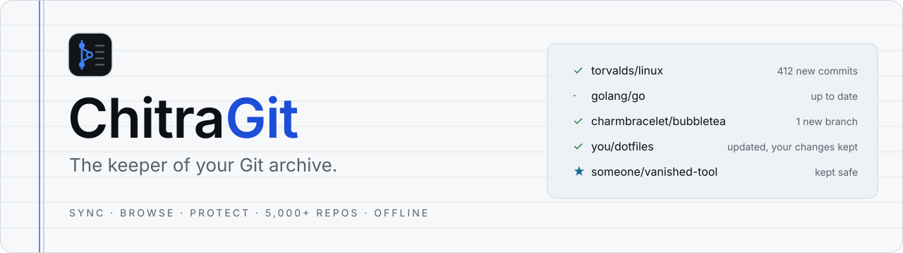
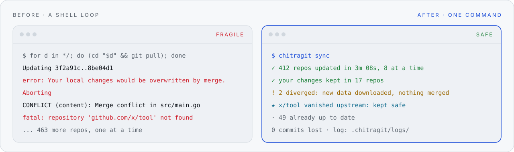
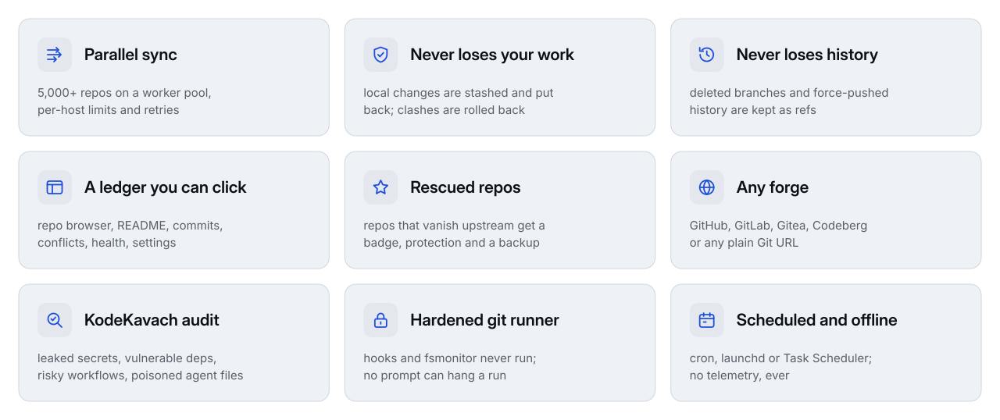
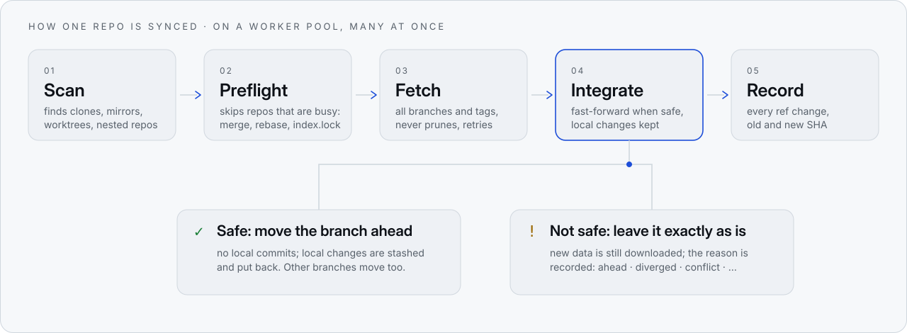
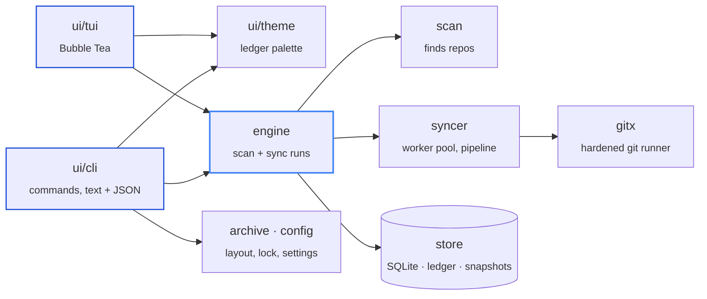

<div align="center">

<picture>
  <source media="(prefers-color-scheme: dark)" srcset="docs/assets/banner-dark.svg">
  
</picture>

<br><br>

[](https://github.com/TTox-Tech/chitragit/actions/workflows/ci.yml)
[](go.mod)
[](#install)
[](LICENSE)
[](https://github.com/TTox-Tech/ChitraGit/releases/latest)
[](https://ttox-tech.github.io/ChitraGit/)

### Sync, browse and protect thousands of local Git repos from one clickable terminal ledger.

**[Why](#why-chitragit)** &nbsp;·&nbsp; **[Features](#features)** &nbsp;·&nbsp; **[Install](#install)** &nbsp;·&nbsp; **[Try it](#try-it-in-30-seconds)** &nbsp;·&nbsp; **[How sync works](#how-sync-works)** &nbsp;·&nbsp; **[Time machine](#time-machine)** &nbsp;·&nbsp; **[Roadmap](#roadmap)** &nbsp;·&nbsp; **[FAQ](#faq)** &nbsp;·&nbsp; **[Docs](https://ttox-tech.github.io/ChitraGit/)** &nbsp;·&nbsp; **[Contributing](#contributing)**

</div>

<p align="center">
  <a href="docs/assets/chitragit-ad.mp4">
    <picture>
      <source media="(prefers-reduced-motion: reduce)" srcset="docs/assets/chitragit-ad-poster.png">
      
    </picture>
  </a>
  <br>
  <sub><a href="docs/assets/chitragit-ad.mp4">Watch in 1080p60</a> · a preview of ChitraGit v1.0; some screens show features still being built</sub>
</p>

> [!NOTE]
> **v1.0 is being built in the open.** Sync, the interactive ledger, every forge, KodeKavach and the
> first half of the time machine are on `main` today. Release candidates land on 20 Nov, 4 Dec and
> 18 Dec, and v1.0.0 on 8 Jan 2027. Until the first one, [install from source](#install).
> See the [roadmap](#roadmap) for what each step adds.

<picture>
  <source media="(prefers-color-scheme: dark)" srcset="docs/assets/stats-dark.svg">
  
</picture>

<details>
<summary><b>Watch the interactive ledger</b></summary>

<br>

<p align="center">
  
</p>

</details>

<details>
<summary><b>The same from the command line</b></summary>

<br>

<p align="center">
  
</p>

</details>

## Why ChitraGit?

*Chitragupta* is the divine record-keeper who never forgets a single entry.
ChitraGit does the same for your repos.

If you keep a folder full of cloned repositories (learning material, dependencies,
whole GitHub orgs, "just in case it disappears" copies), you know the pain:
updating them means a fragile shell loop, one `git pull` in the wrong repo leaves your
local work in a mess, and you never notice when an upstream repo is **deleted, made
private or taken down**, which is exactly when your copy becomes precious.

<picture>
  <source media="(prefers-color-scheme: dark)" srcset="docs/assets/before-after-dark.svg">
  
</picture>

ChitraGit is a **local GitHub for your archive, but better**: offline, all in one place,
and actively guarding what you've collected. Every change it makes is snapshotted and written
to a tamper-evident ledger, so any repo can be put back the way it was.

> [!IMPORTANT]
> **Zero data loss is the first rule.** During a sync, ChitraGit only moves a branch
> forward when that is safe. It never merges, never rebases and never deletes your
> commits, and every branch it moves is recorded with its old and new commit. A run
> killed halfway is repaired on the next one.

## Features

<picture>
  <source media="(prefers-color-scheme: dark)" srcset="docs/assets/features-dark.svg">
  
</picture>

<details>
<summary><b>Every feature in detail</b></summary>

<br>

| Feature | |
|---|---|
| **Parallel sync for 5,000+ repos** | A worker pool updates many repos at once, with per-host limits, retries and timeouts. |
| **Never loses your work** | Local changes are stashed (put aside), the branch is updated and the changes are put back. If they clash, the repo is restored exactly as it was. Diverged repos get the new data but are never merged. |
| **Full headless CLI** | Every command has `--json` output and stable exit codes for scripts and schedulers. |
| **Hardened git runner** | Hooks and `core.fsmonitor` inside archived repos never run, and no prompt can hang a run. |
| **Never loses history** | Branches deleted upstream are kept, history replaced by a force-push is saved, and a sync killed halfway is repaired and can resume. |
| **GUI-quality TUI** | Clickable, animated ledger: repo browser, README and commit views, sync screen, conflict resolver, activity feed, health dashboard, settings and a first-run wizard. |
| **Repo history and snapshots** | Every sync records each repo's refs before and after it runs, pinned so `git gc` keeps them. `chitragit history <repo>` shows every new commit, force-push, deleted branch, snapshot and rescue in time order, and `chitragit restore` puts a repo back to any snapshot. |
| **Operation ledger** | Every sync, scan, restore, rescue and resolved conflict is an entry in a hash-chained event log. `chitragit log` shows it, and `chitragit log --verify` recomputes the chain and fails if any entry was changed. |
| **Rescued repos** | When a repo vanishes upstream it gets a badge, delete-protection and an optional single-file backup. |
| **Any forge** | GitHub, GitLab, Gitea / Forgejo / Codeberg or any plain Git URL. Smart skip asks the API what changed; tokens live in your OS keychain. |
| **KodeKavach audit** | `chitragit audit` finds leaked secrets in every repo's files and whole history, dependencies with known vulnerabilities (offline OSV database), risky GitHub Actions workflows and poisoned AI agent files. Read-only, and nothing leaves your machine. |
| **Tested by killing it** | A chaos suite kills the sync at random moments (1,000 times a night on Linux, 200 each on macOS and Windows), fills the disk, drops connections and feeds it odd file names. The rule it checks: zero commits lost. |
| **Scheduling** | Daily or weekly runs with cron, launchd or Task Scheduler, a log per run and a desktop notification when it finishes. No telemetry, ever. |

The full product spec, including 55+ edge cases and how each is handled, is in
[`docs/PRD.md`](docs/PRD.md).

</details>

## Install

ChitraGit is one binary with no dependencies other than Git 2.30+.

> [!TIP]
> Until the first release candidate (20 Nov), the packages and install scripts below have no
> release to download yet. Build from `main` instead:
>
> ```sh
> go install github.com/TTox-Tech/chitragit/cmd/chitragit@main
> ```

Pick your system:

<details open>
<summary><b>Windows</b></summary>

<br>

```powershell
winget install TTox-Tech.ChitraGit
```

Or with [Scoop](https://scoop.sh):

```powershell
scoop bucket add chitragit https://github.com/TTox-Tech/ChitraGit
scoop install chitragit/chitragit
```

Or the PowerShell script:

```powershell
irm https://raw.githubusercontent.com/TTox-Tech/ChitraGit/main/install.ps1 | iex
```

</details>

<details>
<summary><b>macOS and Linux</b></summary>

<br>

```sh
curl -fsSL https://raw.githubusercontent.com/TTox-Tech/ChitraGit/main/install.sh | sh
```

Homebrew arrives with v1.0:

```sh
brew install ttox-tech/tap/chitragit
```

</details>

<details>
<summary><b>From source, or a plain binary</b></summary>

<br>

With [Go 1.26+](https://go.dev/dl/):

```sh
go install github.com/TTox-Tech/chitragit/cmd/chitragit@latest
```

Or download a binary for any OS from [Releases](https://github.com/TTox-Tech/ChitraGit/releases)
and check it against `checksums.txt`.

</details>

The install scripts download the latest release for your OS and CPU and refuse to
install it if its checksum does not match. More options, shell completion and how to
verify a download are in the [install guide](https://ttox-tech.github.io/ChitraGit/install/).

## Try it in 30 seconds

Point it at any folder of clones. Nothing is moved: ChitraGit adds a `.chitragit` folder
for its own records and a small ID to each repo's git config.

```sh
cd ~/my-archive
chit init        # set up this folder as an archive
chit doctor      # check git, LFS, database, config, terminal
chit pull        # find every repo, then update them all in parallel
chit status      # health of every repo from the last sync
chit             # open the interactive ledger
```

`chit` is the short name for `chitragit`, and git's words work: `pull`, `fetch`, `status`,
`log <repo>`, `remote`, `config`, `restore`. See
[Coming from git](https://ttox-tech.github.io/ChitraGit/guide/coming-from-git/).

The [docs site](https://ttox-tech.github.io/ChitraGit/) has a guide to every screen and a
reference for every command and setting.

<details>
<summary><b>More commands</b></summary>

<br>

```sh
chit fetch --dry-run          # ask the remotes what changed; download nothing
chit fetch                    # download only, never move a branch
chit pull --only 'torvalds/*' # just some repos
chit ls --status diverged     # repos that need a decision
chit log torvalds/linux       # everything that happened to one repo
chit pull --json              # versioned JSON ("schema": "chitragit/v1") for scripts
chit --accessible status      # screen-reader friendly: no colour, words instead of symbols
```

The first <kbd>Ctrl</kbd>+<kbd>C</kbd> lets repos that already started finish safely;
a second one exits at once.

</details>

<details>
<summary><b>Scheduled sync</b></summary>

<br>

```sh
chitragit schedule install --daily 02:00            # or --weekly 03:30 --day sun
chitragit schedule status                           # next run, last result, log file
chitragit schedule remove
```

The job goes into your system's own scheduler (cron on Linux, launchd on macOS, Task
Scheduler on Windows) and runs `chitragit sync --headless`: it never asks questions, writes
a log to `.chitragit/logs/` (kept 30 days) and shows a desktop notification at the end.
Your other cron jobs are left exactly as they were, and the old crontab is backed up first.
Turn notifications off with `chitragit config set notify.desktop false`.

</details>

<details>
<summary><b>Exit codes</b></summary>

<br>

| Code | Meaning |
|:-:|---|
| `0` | all good |
| `1` | some repos failed |
| `2` | bad flags or config |
| `3` | another run holds the archive |
| `4` | git missing or too old |
| `5` | `audit` found problems at or above `--fail-on` |
| `130` | stopped with <kbd>Ctrl</kbd>+<kbd>C</kbd> |

</details>

<details>
<summary><b>Configuration</b></summary>

<br>

Settings are layered (later wins): built-in defaults → your config → the archive's
config → `CHITRAGIT_*` environment variables → command-line flags.

```sh
chitragit config set sync.workers 32          # this archive only
chitragit config set --user ui.theme ledger   # all your archives
CHITRAGIT_SYNC_MODE=fetch chitragit ...       # one run
```

To skip folders, list names or globs in `scan.exclude`, or in a `.chitragitignore` file in
the archive root (one pattern per line; a pattern with `/` matches the path from the root).

</details>

## How sync works

<picture>
  <source media="(prefers-color-scheme: dark)" srcset="docs/assets/sync-pipeline-dark.svg">
  
</picture>

- **Scan** finds every repo at any depth: normal clones, bare and mirror clones, linked
  worktrees and repos nested inside other repos. Each one gets a stable ID stored in its
  own git config, so moving or renaming a folder keeps its history.
- **Fetch** downloads new commits, branches and tags from every remote. A branch deleted
  upstream is kept under `refs/chitragit/archived/`, and history replaced by an upstream
  force-push under `refs/chitragit/rewritten/`, so `git log <that ref>` always gets it
  back. Set `sync.prune = true` for plain pruning instead.
- **Integrate** fast-forwards a branch only when that is safe, meaning the branch simply
  moves ahead to the new commits. Branches that are not checked out are moved too,
  without touching any files. Uncommitted and untracked changes are stashed, the branch
  is updated and the changes are put back, staged files still staged; if they clash, the
  repo is restored **exactly** as it was and the summary names the files.
- **Crashes are repaired:** if ChitraGit is killed while updating a repo, the next run puts
  that repo back the way it was. An interrupted sync can continue where it stopped
  (`--resume`) or start over (`--fresh`); `sync.on_interrupted` sets the default.
- **Flaky networks are expected:** a per-repo timeout, retries with exponential backoff,
  a per-host limit (8 at a time for github.com by default) and a fast stop when a host
  is unreachable.

<details>
<summary><b>Every status, explained</b></summary>

<br>

When a repo is not fast-forwarded, the summary says why. The new data is downloaded in
every case except `busy`, `local_only` and `failed`.

| Status | What it means |
|---|---|
| `ok` | up to date, or moved ahead safely |
| `ahead` | you have local commits that are not pushed yet; nothing to apply |
| `conflict` | your local changes clash with the update; the repo was put back exactly as it was. Resolve it with `chitragit conflicts` |
| `resolving` | a conflict resolution is open; sync leaves the repo alone until you `finish` or `abort` it |
| `dirty` | uncommitted changes and `sync.stash_local_changes` is off; updates downloaded but not applied |
| `diverged` | you and upstream both have new commits; nothing was merged |
| `rewritten` | upstream rewrote its history (force-push) and your branch has local work; it was left as it was, and the old history is saved |
| `detached` | detached HEAD; no branch was moved |
| `no_upstream` | the current branch does not track a remote branch |
| `upstream_gone` | the branch it tracks no longer exists upstream |
| `empty` | the current branch has no commits yet |
| `blocked` | the update would overwrite local files |
| `busy` | a merge or rebase is in progress, or git is already running there |
| `local_only` | no remote configured; nothing to sync |
| `worktree` | a linked worktree, synced through its main repo |
| `failed` | an error; the summary gives a plain-language reason and a hint |

</details>

## Time machine

Every sync takes a snapshot of each repo's branches and tags before and after it runs. The
commits a snapshot points to are pinned under `refs/chitragit/snap/`, so `git gc` can never
remove them, and repos that did not change store nothing new.

```sh
chitragit history torvalds/linux        # new commits, force-pushes, deleted branches, snapshots, rescues
chitragit snapshot ls --repo you/tool   # every snapshot of one repo, newest first
chitragit snapshot take --only 'you/*'  # record one now, before you experiment
chitragit restore you/tool --to 42 --dry-run   # show exactly which refs would move
chitragit restore you/tool --to 42 --stash     # move them, keeping uncommitted work
chitragit log --verify                  # the operation ledger, with its hash chain checked
```

A restore first records the current state as a new snapshot, so a restore can itself be
undone, and every ref moves in one transaction. The checked-out branch needs a clean working
tree, or `--stash` to put local changes aside and back.

## Architecture

The engine is headless: the CLI and the TUI only call it and render results.
Every git call goes through one hardened runner.



<details>
<summary><b>Package map</b></summary>

<br>

| Package | Role |
|---|---|
| `cmd/chitragit` | entry point |
| `internal/core` | domain types shared by every layer; imports nothing else |
| `internal/ui/cli` | Cobra commands, text and JSON renderers |
| `internal/ui/tui` | the interactive ledger (Bubble Tea) |
| `internal/ui/theme` | colour palettes and styles shared by the CLI and the TUI |
| `internal/engine` | the only API the CLI and TUI may call: scans, syncs, snapshots, history, restore |
| `internal/scan` | walks the archive and finds every kind of repo |
| `internal/syncer` | worker pool and the per-repo sync pipeline |
| `internal/gitx` | the only place that runs git; adds the security flags |
| `internal/store` | SQLite database: repos, runs, ref changes, snapshots and the hash-chained ledger |
| `internal/archive` | archive layout and the run lock |
| `internal/config` | layered settings and validation |
| `internal/provider` | GitHub, GitLab and Gitea APIs, forge detection from remote URLs |
| `internal/auth` | tokens in the OS keychain, device login |
| `internal/audit` | KodeKavach: secrets, vulnerable dependencies, risky workflows, agent files |
| `internal/guardian` | rescue detection, bundles, delete protection |
| `internal/conflict` | conflict model and resolution sessions |
| `internal/schedule` | cron, launchd and Task Scheduler jobs |
| `internal/notify` · `internal/runlog` | desktop notifications, logs of headless runs |
| `internal/i18n` | translated messages |
| `internal/platform` | OS specifics: paths, signals, terminal detection |
| `internal/chaos` | zero-data-loss tests: random kills, full disk, dropped connections, fuzzing |

</details>

## Roadmap

<picture>
  <source media="(prefers-color-scheme: dark)" srcset="docs/assets/roadmap-dark.svg">
  
</picture>

v1.0.0 turns ChitraGit from a sync tool into a local GitHub with a time machine. It ships in
four phases, each ending in a release candidate. Progress is tracked in the
[pinned roadmap issue](https://github.com/TTox-Tech/chitragit/issues/153).

<details>
<summary><b>What each step delivers</b></summary>

<br>

**Foundation** (done)

- [x] Config, archive database, hardened git runner, `init`, `doctor`, CI on all three OSes
- [x] Scan and parallel sync, stash flow, rollback, crash repair and resume
- [x] The interactive ledger: repo browser, sync screen, activity, health, conflict resolver, settings, first-run wizard
- [x] GitHub, GitLab and Gitea: login, smart skip, rescued repos, follow a user or org
- [x] Scheduling, notifications, KodeKavach audit, release builds, docs site

**Phase 1: Time machine** (rc.1, 20 Nov)

- [x] One engine API for the CLI and TUI
- [x] Hash-chained operation ledger, `chitragit log --verify`
- [x] Snapshots before and after every sync, pinned against `git gc`
- [x] `chitragit history` and `chitragit restore`
- [x] Chaos and fuzz tests: random kills every night on all three OSes
- [ ] CLI polish: update check, shell completions, clearer error hints
- [ ] KodeKavach precision: fewer false positives, a scored test corpus in CI
- [ ] Signed releases (cosign), SBOM, build provenance, Homebrew

**Phase 2: Rewind** (rc.2, 4 Dec)

- [ ] `diff` between snapshots, `undo` a whole run, `verify` the archive end to end, named snapshots
- [ ] Code tab with highlighted files and blame, commit pages with full diffs
- [ ] Repo descriptions, topics, stars and licences kept offline
- [ ] Wikis, gists, releases, issues and pull requests archived beside the code
- [ ] Faster rescans, rate-limit-aware concurrency, a performance budget in CI
- [ ] TUI timeline, command palette, KodeKavach screen

**Phase 3: Reach** (rc.3, 18 Dec)

- [ ] Search every repo at once and land on the line
- [ ] Issues, pull requests, releases and wikis readable offline; compare any two refs
- [ ] Insights, star import, repo lists
- [ ] Bitbucket, Azure DevOps and Sourcehut; partial clones for huge repos
- [ ] Snapshot retention, archive export and import, complete Hindi translation

**v1.0.0: Mirror** (8 Jan 2027)

- [ ] `chitragit serve`: the whole archive as a read-only web UI on localhost
- [ ] `chitragit mirror`: a second, verified copy on another disk or a NAS

</details>

## Design

ChitraGit's look comes from the *bahi-khata*, the Indian account book, written in blue ink:
ink-black pages, ash-grey ruled lines and light text, with **neel** (blue) as the one accent.
Every text colour meets WCAG AA contrast in both light and dark, and all artwork is set in
[M PLUS Code Latin](https://fonts.google.com/specimen/M+PLUS+Code+Latin). See
[`docs/brand.md`](docs/brand.md) for the palette, the logo and how to regenerate the artwork.

## FAQ

<details>
<summary><b>Will it ever merge, rebase or rewrite my branches?</b></summary>

<br>

No. A branch is only moved forward when that is a plain fast-forward. If you and upstream
both have new commits, the new data is downloaded, nothing is merged, and the repo shows as
`diverged` so you can decide.

</details>

<details>
<summary><b>What happens to my uncommitted changes?</b></summary>

<br>

They are stashed, the branch is updated and they are put back, staged files still staged.
If they clash with the update, the repo is restored exactly as it was and the summary names
the files. Turn this off with `sync.stash_local_changes = false` to leave dirty repos alone.

</details>

<details>
<summary><b>What if an upstream repo is deleted or force-pushed?</b></summary>

<br>

Your copy is kept and marked **Rescued**, with delete protection and an optional
single-file backup. Branches deleted upstream are kept under `refs/chitragit/archived/`,
history replaced by a force-push under `refs/chitragit/rewritten/`, and every snapshot can be
restored with `chitragit restore`.

</details>

<details>
<summary><b>Can I undo what a sync did?</b></summary>

<br>

Yes. Every sync snapshots each repo before and after it runs, and `chitragit restore <repo>
--to <snapshot>` puts its branches and tags back exactly as recorded. Find the snapshot with
`chitragit history <repo>`, and add `--dry-run` to see the moves first. Undoing a whole run in
one command comes in phase 2.

</details>

<details>
<summary><b>Does it work with private repos?</b></summary>

<br>

Yes. Git uses your existing credentials as usual. `chitragit auth login github` (or
`gitlab`, `gitea`, `codeberg`, or any host) adds an API token, kept in your OS keychain,
for smart skip, higher rate limits and `chitragit follow` to clone a whole user or org.

</details>

<details>
<summary><b>Does anything leave my machine?</b></summary>

<br>

Only the requests Git and the forge APIs need to sync. There is no telemetry, no account
and no server. The KodeKavach audit runs fully offline.

</details>

<details>
<summary><b>How is this different from a shell loop or a multi-repo tool?</b></summary>

<br>

Those run the same Git command in every folder. ChitraGit is built around keeping an
archive safe: it decides per repo what is safe to do, keeps everything upstream deleted or
rewrote, records every change in a database you can browse, and repairs itself after a
crash.

</details>

## Contributing

Contributions are very welcome, especially translations and themes.
See [CONTRIBUTING.md](CONTRIBUTING.md). If ChitraGit keeps your archive safe, a ⭐ on the
repo helps other people find it.

## License

[MIT](LICENSE) © [TTox.Tech](https://ttox.tech). The code is free to reuse; the ChitraGit name and
logo are not. See [TRADEMARKS.md](TRADEMARKS.md), and [SECURITY.md](SECURITY.md#official-builds)
for how to tell an official build from a copy.
