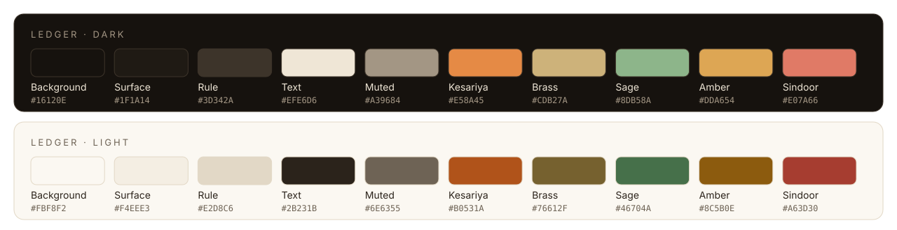

<div align="center">
  
  <h1>ChitraGit look and feel</h1>
  <p><i>One theme, one accent, calm everywhere else.</i></p>
</div>

ChitraGit's look comes from the *bahi-khata*, the red-bound Indian account book that
traders have kept for centuries: ink-brown pages, parchment text, ruled lines and a
margin. This page is the reference for anyone drawing artwork, writing a TUI screen
or proposing a new theme.

## Principles

1. **One accent.** Kesariya (saffron) marks what matters: the primary action, the
   focused element, the brand. Nothing else competes with it.
2. **Status colours are quiet.** Sage, amber, sindoor and brass are muted on purpose.
   They tell you *what happened*; they are not decoration. Every status also has a
   glyph (`✓ · ! ✗ ★`), so colour is never the only signal.
3. **Readable first.** Every text colour meets WCAG AA (the Web Content Accessibility
   Guidelines' minimum): a contrast ratio of at least 4.5:1 against its background, in
   both light and dark. `internal/ui/theme/theme_test.go` fails if a change breaks this.
4. **Ledger motifs, used lightly.** Ruled lines, a margin line and entries written one
   per line. No gradients, no glow, no rainbow.

## Palette



| Role | Dark | Light | Used for |
|---|---|---|---|
| Background | `#16120E` | `#FBF8F2` | page (ink or parchment) |
| Surface | `#1F1A14` | `#F4EEE3` | cards and panels (artwork only) |
| Rule | `#3D342A` | `#E2D8C6` | ledger lines and borders; decorative, never text |
| Text | `#EFE6D6` | `#2B231B` | body text |
| Muted | `#A39684` | `#6E6355` | secondary text, unchanged repos |
| **Kesariya** (accent) | `#E58A45` | `#B0531A` | primary actions, headings, focus, the logo |
| Brass | `#CDB27A` | `#76612F` | hints, the Rescued badge `★` |
| Sage | `#8DB58A` | `#46704A` | success `✓` |
| Amber | `#DDA654` | `#8C5B0E` | warnings and skipped repos `!` |
| Sindoor | `#E07A66` | `#A63D30` | errors `✗` |

The source of truth is [`internal/ui/theme/theme.go`](../internal/ui/theme/theme.go).
The three built-in themes are:

- **`ledger`** (default): picks the light or dark value from the terminal's own
  background, and never paints over it.
- **`ledger-light`**: always the light values, for terminals that report their
  background wrongly.
- **`high-contrast`**: the 16 basic ANSI colours (the ones every terminal can show),
  for low vision and legacy consoles.

## Type

| Use | Font stack |
|---|---|
| Wordmark and headings in artwork | a book serif: Iowan Old Style, Palatino, Georgia |
| Body text in artwork | the system sans: San Francisco, Segoe UI, Inter, Helvetica |
| Terminal and code | the system monospace: SF Mono, Menlo, Consolas, DejaVu Sans Mono |

SVG images on GitHub cannot load web fonts, so artwork only uses fonts that ship with
the reader's operating system.

## Logo


A ledger page whose margin line is a small commit graph: a branch leaves the line and
rejoins it, next to four ruled entries. Use it on its own ink tile, as drawn; do not
recolour it, add effects or place it on a busy background. The wordmark is
"Chitra" in Text and "Git" in Kesariya, set in the book serif.

## Artwork

Everything in [`docs/assets`](assets) is generated from one palette table:

```sh
python3 docs/assets/src/gen.py docs/assets
```

| File | Where it is used |
|---|---|
| `banner-light.svg`, `banner-dark.svg` | README hero; GitHub picks one with `<picture>` |
| `demo-sync.svg` | animated terminal in the README; respects reduced motion |
| `sync-pipeline-*.svg`, `roadmap-*.svg` | README diagrams |
| `palette.svg`, `logo.svg` | this page |
| `social-preview.png` | link previews; upload it in **Settings → General → Social preview** |

If you change a colour, change it in `theme.go` and `gen.py` together, run
`go test ./internal/ui/theme` and regenerate the artwork. `social-preview.png` is a
1280×640 screenshot of `social-preview.svg`; re-export it after changing the SVG.

## Proposing a theme

User themes will load from TOML (PRD F18). Until then, a new built-in theme is a new
entry in the `palettes` map in `theme.go`. It must keep every text colour at 4.5:1 or
more against its background (add it to the contrast test) and keep a single accent.
