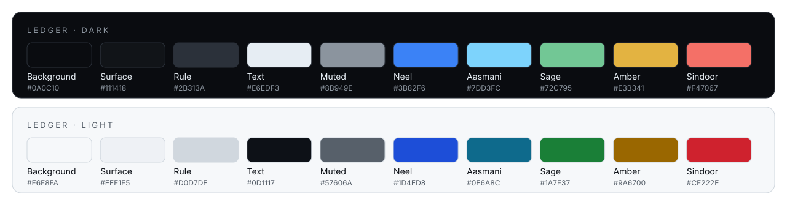

<div align="center">
  
  <h1>ChitraGit look and feel</h1>
  <p><i>One theme, one accent, calm everywhere else.</i></p>
</div>

ChitraGit's look comes from the *bahi-khata*, the Indian account book that traders have
kept for centuries, here written in blue ink: *syahi* (ink-black) pages, *raakh*
(ash-grey) ruled lines and a margin, and *neel* (blue) for the hand that writes. This page is the reference for anyone drawing artwork, writing a TUI screen
or proposing a new theme.

## Principles

1. **One accent.** Neel (blue) marks what matters: the primary action, the
   focused element, the brand. Nothing else competes with it.
2. **Status colours are quiet.** Sage, amber, sindoor and aasmani are muted on purpose.
   They tell you *what happened*; they are not decoration. Every status also has a
   glyph (`✓ · ! ✗ ★`), so colour is never the only signal.
3. **Readable first.** Every text colour meets WCAG AA (the Web Content Accessibility
   Guidelines' minimum): a contrast ratio of at least 4.5:1 against its background, in
   both light and dark. `internal/ui/theme/theme_test.go` fails if a change breaks this.
4. **Ledger motifs, used lightly.** Ruled lines, a margin line and entries written one
   per line. No gradients, no glow, no rainbow.

## Palette



| Role | Dark | Light | Used for |
|---|---|---|---|
| Background | `#0A0C10` | `#F6F8FA` | page (ink-black or paper-white) |
| Surface | `#111418` | `#EEF1F5` | cards and panels (artwork only) |
| Rule | `#2B313A` | `#D0D7DE` | ledger lines and borders; decorative, never text |
| Text | `#E6EDF3` | `#0D1117` | body text |
| Muted | `#8B949E` | `#57606A` | secondary text, unchanged repos |
| **Neel** (accent) | `#3B82F6` | `#1D4ED8` | primary actions, headings, focus, the logo |
| Aasmani | `#7DD3FC` | `#0E6A8C` | hints, the Rescued badge `★` |
| Sage | `#72C795` | `#1A7F37` | success `✓` |
| Amber | `#E3B341` | `#9A6700` | warnings and skipped repos `!` |
| Sindoor | `#F47067` | `#CF222E` | errors `✗` |

The source of truth is [`internal/ui/theme/theme.go`](../internal/ui/theme/theme.go).
The three built-in themes are:

- **`ledger`** (default): picks the light or dark value from the terminal's own
  background, and never paints over it.
- **`ledger-light`**: always the light values, for terminals that report their
  background wrongly.
- **`high-contrast`**: the 16 basic ANSI colours (the ones every terminal can show),
  for low vision and legacy consoles.

## Type

One type system everywhere: in the artwork, on the docs site and in the text banners.

| Use | Typeface |
|---|---|
| Wordmark, titles and headings | **Inter Display** SemiBold |
| Tagline and body text | **Inter** |
| Terminal text and code | **JetBrains Mono** |

The fonts live in [`docs/assets/fonts`](assets/fonts) (SIL Open Font License). SVG
images on GitHub cannot load web fonts, so `gen.py` embeds them inside each SVG, cut
down to the letters that SVG uses; every reader sees the same letters on every OS.
The docs site loads the same files from `ledger.css`.

## Logo


A ledger page whose margin line is a small commit graph: a branch leaves the line and
rejoins it, next to four ruled entries. Use it on its own ink tile, as drawn; do not
recolour it, add effects or place it on a busy background. The wordmark is
"Chitra" in Text and "Git" in Neel, set in Inter Display SemiBold.

## Artwork

Everything in [`docs/assets`](assets) is generated from one palette table:

```sh
python3 docs/assets/src/gen.py docs/assets
```

| File | Where it is used |
|---|---|
| `banner-light.svg`, `banner-dark.svg` | README hero; GitHub picks one with `<picture>` |
| `chitragit-ad.gif`, `chitragit-ad.mp4`, `chitragit-ad-poster.png` | 2-minute promo: the GIF (800 px, 24 fps) is the README hero, the MP4 (1080p60) plays on the docs site, the poster is the still for reduced motion. Rendered from [`src/ad`](assets/src/ad) |
| `demo-sync.svg` | animated terminal in the README; respects reduced motion |
| `sync-pipeline-*.svg`, `roadmap-*.svg` | README diagrams |
| `stats-*.svg`, `before-after-*.svg`, `features-*.svg` | README stats strip, shell loop vs `chitragit sync`, and the feature grid |
| `palette.svg`, `logo.svg` | this page |
| `social-preview.png` | link previews; upload it in **Settings → General → Social preview** |

The promo is one HTML timeline (`docs/assets/src/ad/ad.html`) in which every frame is a pure
function of time. `render.mjs` steps through it with Playwright and builds the files with ffmpeg
and gifsicle:

```sh
node docs/assets/src/ad/render.mjs /tmp/ad          # ~20 min: 7,200 frames at 1080p60
cp /tmp/ad/chitragit-ad.{gif,mp4} /tmp/ad/chitragit-ad-poster.png docs/assets/
```

Its voiceover script and on-screen captions live in the `SUBS` table at the top of the timeline.

The demo GIFs (`demo-tui.gif`, `demo-cli.gif`) are recorded with [VHS](https://github.com/charmbracelet/vhs)
from `docs/demo/*.tape`; the terminal theme in each tape uses the same hex values.

### Text banner

For places that only show text (release notes, a terminal, a plain README),
[`docs/assets/ascii`](assets/ascii) has the logo and wordmark drawn in Unicode box and
block characters: `banner.txt` (98 columns), `banner-compact.txt` (fits 60 columns) and
`banner-ascii.txt` (plain ASCII for legacy consoles). The `.ansi` files are the same
banners in the palette, for `cat` in a true-colour terminal.

```text
╭─────────╮
│ ●╮   ━━ │
│ │╰◯  ━━ │   █▀▀ █ █ █ ▀█▀ █▀█ ▄▀█   █▀▀ █ ▀█▀
│ │╭╯  ━━ │   █▄▄ █▀█ █  █  █▀▄ █▀█   █▄█ █  █
│ ●╯   ━━ │
╰─────────╯   The keeper of your Git archive.
```

If you change a colour, change it in `theme.go`, `gen.py` and the two tapes together, run
`go test ./internal/ui/theme` and regenerate the artwork. `social-preview.png` is a
1280×640 screenshot of `social-preview.svg`; re-export it after changing the SVG.

## Proposing a theme

User themes will load from TOML (PRD F18). Until then, a new built-in theme is a new
entry in the `palettes` map in `theme.go`. It must keep every text colour at 4.5:1 or
more against its background (add it to the contrast test) and keep a single accent.
